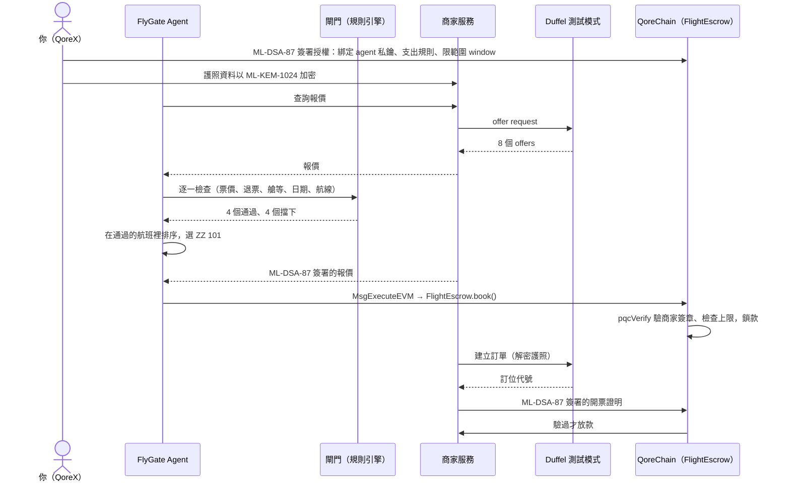

# FlyGate 整體流程設計

> 網頁介面全部是英文；這份文件給團隊看，用中文寫，按鈕名稱照網頁上的英文。

> 目標：評審在 3 分鐘內看懂三件事。
> 1. AI 真的會幫你訂票。
> 2. 每一筆錢都被鏈上規則管住。
> 3. 就算私鑰被偷、量子電腦來了，錢也不會被拿走。

## 設計原則

| 原則 | 做法 |
|---|---|
| **看起來像真的訂票網站** | 版面沿用大家熟悉的 OTA 樣式：藍色主視覺、白色搜尋卡、左側功能列、日期價格列、航班列表、藍色價格。評審不用學就看得懂。 |
| **讓看不見的閘門看得見** | 簽署後頂部一直顯示「授權狀態列」（已花／上限／到期／agent 私鑰狀態）。每張航班卡片底部都有閘門結果。下單時用逐步的「通關進度」呈現。 |
| **AI 理解，程式決定** | 畫面上分成兩種角色：藍色是 **Agent**，負責理解需求、排序航班；綠色是 **閘門**，用固定的程式和鏈上規則決定能不能買。右側動態紀錄寫明是誰做了什麼。 |
| **每個「出事」都有畫面** | 票價變動會被閘門擋下；下單失敗會自動退款；私鑰外洩有攻擊演習。這三段是贏過其他作品的關鍵。 |
| **誠實標示真假** | 簽章與加密在瀏覽器裡實際計算，標成紫色「Real crypto」；FlightEscrow 合約真的部署在 diana，結帳頁標成「Real · diana」並連到瀏覽器；頁面上的交易雜湊仍是模擬的，標成灰色「Simulated tx」。 |

## 六個畫面

| # | 路徑 | 畫面 | 評審要看到什麼 | 對應評分項目 |
|---|---|---|---|---|
| 1 | `/` | 首頁搜尋 | 一句話「Taipei to Tokyo, Dec 20, economy, refundable, max $400」自動拆成欄位，下方即時顯示 6 條鏈上規則 | 清晰度、原創性 |
| 2 | `/mandate` | 簽署授權 | 授權畫成登機證；表格說明每個條件對應哪個 QoreChain 機制；QoreX 錢包用 ML-DSA-87 簽章，並用 ML-KEM-1024 加密護照 | QoreChain 技術、後量子正確性 |
| 3 | `/search` | Agent 比價 | 8 個報價逐一過閘門：不可退、超過上限、商務艙、日期不符的全部擋下並寫出原因。Agent 從通過的航班中選一班，說明理由，然後倒數 5 秒自動下單 | 能照描述運作、AI 理解／程式決定 |
| 4 | `/checkout` | 閘門通關 | 8 道關卡逐步打勾：商家簽報價 → `pqcVerify` → 規則比對 → 鎖款 → Duffel 下單 → 開票 → 開票證明 → 放款 | 能照描述運作、QoreChain 技術 |
| 5 | `/ticket` | 電子機票 | 訂位代號、登機證樣式的電子票，下方列出 8 筆可獨立驗證的證明 | 清晰度 |
| 6 | `/drill` | 私鑰外洩演習 | 拿外洩的 agent 私鑰發動 5 次攻擊（含 Q-Day），全部被鏈上擋下；你用一個 ML-DSA-87 簽名撤銷 agent，第 6 次攻擊也失敗 | 後量子正確性、原創性 |

## 流程圖



出事的分支：

- **票價變動**：商家報價變成 US$428，規則比對失敗，agent 停在付款之前。畫面提供「Book FA 802 · US$389 instead」和「Back to search」。
- **下單失敗**：錢已鎖進合約，但 Duffel 下單失敗，合約自動退款，畫面提供「Search again」。

## 狀態機

```
授權草稿 ──簽署──▶ 已簽署
                   │
                   ▼
Agent：讀取授權 → 查價 → 閘門檢查 → 排序 → 倒數 ──▶ 交給下單
                                        └─暫停─▶ 你自己選
                   │
                   ▼
下單：報價 → 驗簽 → 規則 ─失敗─▶ 已擋下（錢沒動）
                     │
                     ▼
                   鎖款 → 下單 ─失敗─▶ 退款（錢回來）
                           │
                           ▼
                     開票 → 開票證明 → 放款 ──▶ 出票成功
```

狀態集中在 `src/lib/store.tsx`，並存進 sessionStorage，重新整理頁面也不會中斷 Demo。

## Demo 控制台（給上台的人）

右下角藍色圓鈕，或按鍵盤 **D**。

- **Next booking scenario**：Ticketed／Fare jumps／Booking fails。觸發一次後會自動回到 Ticketed，方便接著示範改訂。
- **Speed**：錄影用 1×，現場趕時間用 2×。
- **Jump to**：直接跳到任一畫面。
- **Reset demo**：清空狀態回到首頁。

## 3 分鐘 Demo 怎麼點

開場前：控制台先選好「Fare jumps」。這樣一次流程就能同時示範「被擋下」和「改訂成功」。

| 時間 | 動作 | 畫面 |
|---|---|---|
| 0:00–0:20 | 首頁不點任何東西，講痛點 | `/` |
| 0:20–0:45 | Parse → Create mandate → Sign with QoreX → Sign | `/` → `/mandate` |
| 0:45–1:15 | Let the agent book，讓它自己查價、過閘門、排序、倒數下單 | `/search` |
| 1:15–1:50 | 商家報價漲到 US$428，閘門擋下，錢沒動 → Book FA 802 · US$389 instead → 8 道關卡全過 → 自動跳到電子機票 | `/checkout` → `/ticket` |
| 1:50–2:05 | 播一段事先錄好的「下單失敗、自動退款」10 秒片段（控制台選「Booking fails」錄製） | 錄影 |
| 2:05–2:40 | Start breach drill → Start attack → Revoke agent (ML-DSA-87) → Attack again with old key | `/drill` |
| 2:40–3:00 | 回到電子機票頁的 Proofs 區塊收尾 | `/ticket#proofs` |

錄影時把控制台的動畫速度設成 1×；現場時間不夠就切到 2×。

## 哪些是真的，哪些是模擬

| 項目 | 目前 | 接上真實服務的做法 |
|---|---|---|
| ML-DSA-87 簽章（授權、報價、開票證明、撤銷） | **真的**，`@noble/post-quantum` 在瀏覽器執行 | owner 改由 QoreX 錢包簽；商家金鑰放在商家伺服器 |
| `pqcVerify` 驗證 | **真的演算法**，在瀏覽器驗 | 改成 FlightEscrow 合約呼叫預編譯 `0x…0a01` |
| ML-KEM-1024 護照加密 | **真的**，KEM ＋ AES-256-GCM | 商家 KEM 公鑰用 `MsgRegisterKEMKey` 註冊上鏈 |
| 閘門規則檢查 | **真的**，`src/lib/gate.ts` | 保留，並在合約裡重複檢查 |
| 一句話解析 | 規則式解析（`parseIntent`） | 換成 Claude，解析結果仍要經過同一個閘門 |
| 航班報價、訂單 | 模擬資料（Duffel Airways ＋ 虛構航空公司） | Next.js route handler 呼叫 Duffel 測試模式 API |
| 鎖款（`book()`，`pqcVerify` 驗商家報價） | **真的（diana）**：[book](https://explore.qore.network/tx/0x68557823256ccc7a0b01f8b7814de520ae66998574fec8df5a7d879c823e0a2c)，351,734 gas | 網頁顯示 `FlightEscrow` [`0xAEF0d6a8…CE10`](https://explore.qore.network/address/0xAEF0d6a8B85A9a95091818c3142B8b065C7fCE10)（Real · diana），交易雜湊仍是模擬的 |
| 放款（`confirmTicket()` 驗開票證明，發出 `Released`） | **真的（diana）**：[confirmTicket](https://explore.qore.network/tx/0xe8050f43da7c493cd40d1dfcf468e5f0d20ee1960912c1ec6d9924790ba5e971)，238,661 gas，商家收到 1 QOR | 同上 |
| 退款（`cancel()` 商家失敗證明；`refund()` 逾時） | **真的（diana）**：[book](https://explore.qore.network/tx/0x1c3d97028798fdd7d1c59a2b4e618f175d2fe351b0fab2b8e7dc52835f491565) → [cancel](https://explore.qore.network/tx/0x830326a3215b838fcf00ffbdfbfe6a39a8f87d6613c10cfbfcfc208f9eb40717)（243,690 gas）；[book](https://explore.qore.network/tx/0xf73140e3e3c6fb08c14d63710d1702bea8f7b48815ce355b9e96783906db9540) → 等 120 秒 → [refund](https://explore.qore.network/tx/0x1e17565c5ee8d038c1d76589fbbdc2777aed214bccca00d03f0b85571bca5d95)（50,112 gas）；退款都回到 owner | 同上 |
| 其他鏈上交易（綁定 agent 私鑰、支出規則） | 模擬，交易雜湊是隨機值 | `@qorechain/sdk`：`linkAuthenticatorMsgs` |
| 攻擊錯誤碼 | 取自 QoreChain 文件 | 在 diana 測試網實際送出攻擊交易 |

## 接上真實服務的順序

QoreChain 規定 agent 必須真的在鏈上動作，所以要按這個順序把模擬換掉：

1. **鏈上部分**（`src/lib/chain.ts`）：建立 owner、agent、商家三個 diana 帳號；用 `ensurePqcRegistered` 註冊 ML-DSA-87；`linkAuthenticatorMsgs` 綁定 agent 私鑰與支出規則；`openEvmWindowMsg` 開限範圍 window。
2. ~~**FlightEscrow 合約**：`book()` 呼叫 `pqcVerify` 驗商家報價並鎖款；`confirmTicket()` 驗開票證明後放款；`refund()` 逾時或失敗時退款。用 Foundry 寫測試。~~ **完成**：已部署到 diana [`0xAEF0d6a8B85A9a95091818c3142B8b065C7fCE10`](https://explore.qore.network/address/0xAEF0d6a8B85A9a95091818c3142B8b065C7fCE10)（[部署交易](https://explore.qore.network/tx/0x45559abede2aba2ebba1cfe6566c0fa96cdfb20b31bbdab74ae991726502e4c5)，區塊 10664415；[setMandate](https://explore.qore.network/tx/0x02d1605f7d54bbc8df2ca78b19ba8713a6ca6639f4ec1786f19f6e7255553d4c)），三種結果都在測試網跑過。授權以 (owner, agent) 為鍵：誰呼叫 `setMandate` 就只寫自己那一格，報價裡由商家簽進 `owner`，退款回給它。這輪的鏈上準備：agent signer 只補差額 1.722955 QOR（[bank send](https://explore.qore.network/tx/42A7A3A1101F815A20F1BDF150118BED03EBD6F3D4536A609BEFD787E5F30A26)）；owner [EVM window](https://explore.qore.network/tx/C0DB65EAF0D5B6F38B88487137C0D4C0F5A153F62E4F617F40211EC18D21B47C)（2 筆，只夠部署＋setMandate 的 gas）；agent [EVM window](https://explore.qore.network/tx/EA5D9E79F5A2016A61894E508FE678285CA46C5A7AC082A5AD0E4D139CDD19DD)（6 筆，3 × 1 QOR ＋ gas，只能打新合約）；兩個 window 都是 900 區塊（約 15 分鐘）。紀錄在 `deployments/diana.json`；重跑用 `pnpm escrow:deploy`、`pnpm escrow:e2e`。

   **已取代**：第一版 [`0x7e9eCaBf…D97C`](https://explore.qore.network/address/0x7e9eCaBf07fAde561d4022A53ca7865c7531D97C)（[部署](https://explore.qore.network/tx/0x1c246db3ab6b4c90c7fd0b12e3dc0707a241d4d00d9b1cf3b9dbfc7902bd3a9f)，區塊 10662861）讓第一個呼叫 `setMandate` 的人永遠成為 agent 的 owner，可以被搶先，所以換掉。它的三種結果：[book](https://explore.qore.network/tx/0xe1e2d8823921c4c6887846000c565f35eaa1e22ccf0a6b251c4c503f4ec6a542) → [confirmTicket](https://explore.qore.network/tx/0xe2b5472ae2a4868beee1579f6dc1c4a35c4c9d9ea161e781beb67728b9763549)；[book](https://explore.qore.network/tx/0x13e9ae56fd461ff852e2da1e07d78134aa755c2e136744fabd6b54a3364a8e53) → [cancel](https://explore.qore.network/tx/0x427a462c072396b584baa7ccb6423c87d864f3e69d0bac8aa5fc9e1bf3fa71b1)；[book](https://explore.qore.network/tx/0x885a27e40fd0426167a3258f670eeb54527fe422e348d90add8e14cfe148bda8) → [refund](https://explore.qore.network/tx/0x1c0088f2f3bd4750d827da6774ef22957e9c6e585d4ee7454528d8420aa81dd6)。紀錄在 `deployments/diana.json` 的 `superseded`。

   合約測試：先 `pnpm install`，再直接 `forge test`。預設就開 ffi，`contracts/test/ffi` 會呼叫 `node_modules/.bin/tsx scripts/escrow-ffi.ts`，用真的 ML-DSA-87 交叉驗證 `src/lib/escrow.ts` 和合約簽的是同一組位元組；沒先裝套件，這幾個測試會失敗。
3. **Duffel**：新增 `src/app/api/offers/route.ts` 與 `src/app/api/orders/route.ts`，金鑰只放在伺服器環境變數 `DUFFEL_TEST_TOKEN`。
4. **攻擊演習**：把 `runOne()` 改成真的用 agent 私鑰送交易，錯誤碼直接顯示鏈上回傳的結果。
5. **Claude**：把 `parseIntent()` 換成 Claude，排序理由也由 Claude 產生；閘門與合約不變。

## diana 測試網實測記錄

2026-11-24 以 `@qorechain/sdk@0.14.0` 實測，後續工作直接沿用，不用重查。

**瀏覽器打包結論：可打包。** 在 repo 外用 esbuild 0.28.2 `--bundle --platform=browser --format=esm` 打包一支 import 並呼叫 `createClient`、`generateMnemonic`、`deriveNativeAccount`、`derivePqcCanonical`、`directSignerFromPrivateKey`、`client.connectTx`、`fetchPqcStatus` 的小檔：

- 成功，零錯誤、零警告，不需要任何 Node 內建模組 polyfill（沒有 `node:`／`fs`／`crypto` 匯入）。
- 體積：未壓縮 5.8 MB，minify 後 2.9 MB，gzip 後約 560 KB。大宗是 `cosmjs-types`、SDK 本身、`viem`；前端若要用，必須動態 `import()`，不要放進首屏。
- 程式裡的 `Buffer`、`process.versions` 都有 `typeof` 判斷，瀏覽器會走 `atob`／`btoa` 分支。唯一沒判斷的是 `cosmjs-types` 的 `setPaginationParams`（帶 `pagination.key` 的分頁查詢才會走到），用到時要另外處理。
- 只驗證打包，還沒在真實瀏覽器跑過。owner 簽章可以留在前端做，agent／商家金鑰仍照原計畫放伺服器端。

**測試網事實：**

| 項目 | 實測 |
|---|---|
| 水龍頭 | 必須手動：`dashboard.qorechain.io/faucet`，需登入 dashboard、沒有公開 API；每帳號、每地址 24 小時各 100 QOR |
| 出塊時間 | 約 1.03 秒（主網約 3.1 秒），chain v3.2.6，已支援擁有證明 |
| 公開端點 | `rpc-testnet.qore.host`、`api-testnet.qore.host`、`evm-testnet.qore.host` 每 IP 限流，腳本要重試 |
| PQC 狀態查詢 | REST `GET {rest}/qorechain/pqc/v1/account/{address}`（SDK `fetchPqcStatus`）；公開端點不提供 `qor_*` JSON-RPC |
| EVM 端的帳號 | bootstrap 帳號（coin 118）在 EVM 端就是 qor1 那 20 bytes 的 hex：餘額相同，`pqcKeyStatus`（eth_call 0x…0A02）也查得到它的 ML-DSA-87 金鑰。但沒有 EVM 私鑰能從這個地址送交易（EVM 送件人是 keccak(pubkey)）。所以每個角色有兩個 EVM 地址：account（商家地址、收款、查金鑰用）與 signer（同一組助記詞的 coin-60 金鑰，送 deploy／setMandate／book 用，要另外補款）。`pnpm evm:check` 唯讀檢查，`scripts/evm/` 提供 helper |
| EVM 交易的門檻 | 送 EVM 交易的帳號必須（1）自己註冊 ML-DSA-87 金鑰，並附擁有證明；（2）先用混合簽章的 Cosmos 交易 `MsgOpenEVMWindow` 開一個 EVM window，限定區塊數、交易數、總額（`maxValue` 以 uqor 計，包含轉帳金額加上每筆的 gasLimit × maxFeePerGas），還可以限定收款合約（`allowedTargets`）。少了任何一項，EVM RPC 會回 `no usable registered post-quantum key` / `no open EVM authorisation window`。coin-60 signer 用 SDK 的 `deriveUnifiedAccount` + `EthNativeSigner` 簽 Cosmos 交易（註冊用 classical，開 window 用 hybrid）。開 window 會讓 EVM nonce 加一。`scripts/escrow/native.ts` 有這兩步，都會先查鏈上狀態才送 |
| forge 廣播 | `forge script --broadcast` 被拒時會自己重送（"after 4 attempts"）。所以部署只用 forge 模擬，再由 `scripts/escrow/tx.ts` 簽名並只送一次；送出出錯時會先查 receipt 和 nonce，不會重送 |
| EVM gas（實測） | base fee 100 gwei；現行合約：部署 1,673,638、`setMandate` 140,660、`book` 351,734、`confirmTicket` 238,661、`cancel` 243,690、`refund` 50,112（第一版：部署 1,661,885、`setMandate` 140,777、`book` 350,823、`confirmTicket` 239,069、`cancel` 243,746、`refund` 50,026）。`pqcVerify` 單獨呼叫估計約 312k（含 calldata） |

## 檔案地圖

```
src/
  app/
    page.tsx            首頁搜尋（一句話解析、閘門條件）
    mandate/page.tsx    簽署授權（ML-DSA-87、ML-KEM-1024）
    search/page.tsx     Agent 比價（閘門檢查、排序、倒數下單）
    checkout/page.tsx   閘門通關（8 道關卡、擋下、退款）
    ticket/page.tsx     電子機票與鏈上證明
    drill/page.tsx      私鑰外洩演習
  components/           Header、GateBar、FlowSteps、FlightCard、AgentFeed、WalletModal、PresenterPanel…
  lib/
    gate.ts             閘門規則（決定能不能買）
    mandate.ts          授權格式、一句話解析、規則對照
    pq.ts               ML-DSA-87 / ML-KEM-1024（真的）
    chain.ts            QoreChain 模擬層（之後換成 SDK）
    booking.ts          通關步驟定義
    offers.ts           Demo 航班資料
    store.tsx           Demo 狀態
```
